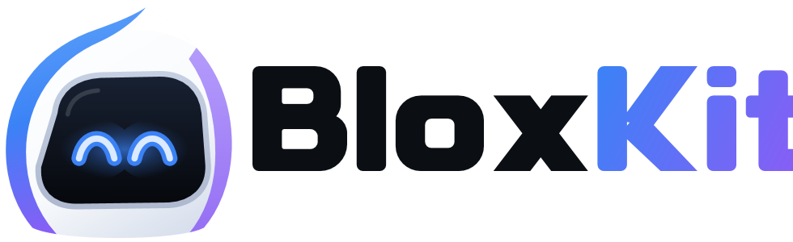
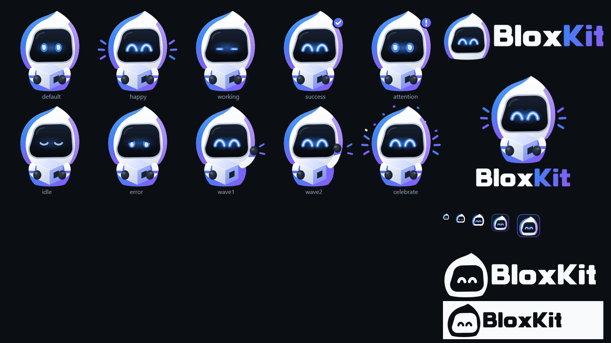

<p align="center">
  <picture>
    <source media="(prefers-color-scheme: dark)" srcset="assets/brand/logo-horizontal.png">
    
  </picture>
</p>

<p align="center">
  Open several Roblox accounts, watch every window live, keep them from going idle,<br>
  and get told when one is kicked. Windows 10 or 11 and Google Chrome; nothing to install.
</p>

> BloxKit is an independent project. It is not made by, endorsed by, or affiliated with Roblox Corporation.
> Some games forbid AFK farming in their own rules: check before using it.

---

## Start

Double-click **BloxKit.exe**. Keep all the files in this folder together (the app runs `BloxKit.ps1` from the same folder).
Right-click BloxKit.exe > **Pin to Start** or **Pin to taskbar** to keep it handy.

If Windows shows "Windows protected your PC": click **More info** > **Run anyway**. The app isn't signed, so Windows doesn't know it yet.

BloxKit.exe is built from `launcher\BloxKit.cs`. To build it yourself (nothing to install, it uses the C# compiler that comes with Windows):

```
powershell -ExecutionPolicy Bypass -File tools\build-app.ps1
```

It never sees your passwords. Chrome keeps your logins, not this app.

## The tabs

| Tab | What's there |
| --- | --- |
| **Accounts** | your accounts, where they should go, and opening them |
| **Groups** | named sets of accounts, their status, opening a whole group |
| **Schedule** | groups one after another, each for a set time |
| **Live screens** | a live wall of every Roblox window, and anti-AFK |
| **Settings** | timing, performance, Chrome setup, alerts, scheduled start, backup |

The header shows the BloxKit mascot and a line saying what's going on right now (opening accounts, everyone in, an account kicked, nothing running). At the top right, the pill says **Multi-window ON**. If it's orange, click **Close Roblox and turn on**.

## First-time setup (about 5 minutes)

Example: your accounts are Main, Alt1, Alt2.

1. Accounts tab > **+ Add account**.
   - Nickname: Main (the box suggests one).
   - Roblox profile link: open Main's profile on roblox.com and copy the link (looks like `roblox.com/users/12345/profile`).
   - Pick **A new Chrome profile** (or one you already have). Log in once.

   The first account becomes your **main** (gold star).
2. Add Alt1 and Alt2 the same way (profile link not needed).
3. In Roblox: make each alt friends with Main. On Main: Settings > Privacy > "Who can join me in experiences?" = Friends.
4. Task Manager > Startup apps > disable Roblox.
5. The first time Chrome asks "Open Roblox?": tick **Always allow**, click **Open**.
6. Optional auto-join: on each account, **...** > **Set up auto-click helper**, then tick **Auto-click Play / Join for me**.
   Already had the helper before? Click its reload arrow on `chrome://extensions` in each Chrome profile, so the new version (2.2) loads.

## Every day: one click

1. Paste a game link (or pick one from **Saved**).
2. Click **Start everything**.
   - Main opens and joins the game.
   - The app waits until Main is in (20 sec by default).
   - Then each alt opens **one at a time** and joins Main's server. The next alt only starts after the last one's Roblox window shows up, plus a short wait (8 sec by default). No more pile-ups.
3. Watch the progress bar. **Cancel** stops it. If an account didn't load, click **Retry the ones that didn't load**.

**Closing the launch tab** (optional, off by default): Settings > Opening accounts > "Close the Chrome tab a launch came from". "When it's in a game" closes that one tab once Roblox's log says the account joined a server. If the launch fails, is cancelled, or can't be confirmed, the tab stays open. Other tabs are never touched. It needs helper 2.2 in each Chrome profile (on `chrome://extensions` in that profile, click the helper's round reload arrow once); accounts that still have the older helper show a "setup" chip. How it works: the helper asks BloxKit on this PC (127.0.0.1 only) "did this launch work?" every 2 seconds, and closes only the tab that asked when the answer is yes.

Other buttons:

| Button | What it does |
| --- | --- |
| Open ticked accounts | opens only the ticked ones (skips ones already open) |
| Open ALL alts | every account except your main |
| Use my main's server | fills in your main's profile link |

## Accounts list

| Part | Meaning |
| --- | --- |
| checkbox | include in "Open ticked accounts" |
| dot | **green** in game (Roblox's own log says the server accepted it) · **blue** opening, starting, or joining a server · **slate** Roblox is open but not in a game, or its log couldn't be found · **orange** didn't load, or needs sign-in on this PC · **red** disconnected, or window closed/kicked · **grey** not open. The words next to it always say the same thing. A Roblox window alone is never shown as "in game". |
| setup chip | "setup (1)" next to a name: something in that account's Chrome profile still needs doing (auto-click helper not installed, or "Always allow" Roblox not ticked yet). Hover it, or use **...** > **Check Chrome setup**. The app only reads Chrome's files, it never changes them. |
| star | make this your main |
| Open / Show | open this account, or jump to its window if it's already open (clicking Open again while it's opening won't open it twice) |
| ... | edit, check Chrome setup, set up auto-click, log in again, move up/down, remove |

Which window is which account: each opened account is matched to the Roblox window whose program started after that account was opened. A slow window that shows up after the app gave up on it is still named correctly (and taken off the retry list). A Roblox window you open yourself stays unnamed; type the account's name on its screen to link it.

Groups: tick some accounts, click **Save ticked as group** (like "Farm team"). Later, pick the group from the **Group** box to tick just those accounts.

## Groups tab

- **Left:** your groups. Each shows how many accounts, a star if your main is in it, and a status: *Draft* (no accounts yet), *Ready* (everyone is set up, nobody open yet), *Needs setup* (someone needs to sign in or finish Chrome setup), *Partly open*, *Running* (everyone is open), *Opening*. Plus **+ New group**, **Move up**, **Move down**.
- **Middle:** who's in the picked group, with each account's live status and the other groups it's in. **Remove** takes an account out of this group only. **Edit members** opens a list with search, a filter (Main, Alts, Open now, Not open, In a group, In no group), and **Tick all shown** / **Untick all shown**. **Rename**, **Duplicate**, **Delete** (asks first; the accounts stay).
- **Right:** **Open all** / **Open the N not open** opens them one at a time with the link on the Accounts tab. **Tick just these on the Accounts tab** ticks the group's accounts there.

In a narrow window, the right part moves under the middle one. An account can be in more than one group.

## Schedule tab (groups one after another)

Example: "Group A" (Main + Alt 1-3) for 60 minutes, then "Group B" (Main + Alt 4-6) for 60 minutes.

1. Left: pick a group, click **+ Add**. Type its minutes. Arrows change the order, X removes a step (locked while the schedule runs).
2. Paste the game link on the Accounts tab (the schedule keeps the link it started with).
3. Click **Start**.

What happens:

- The group's accounts open one at a time (with "A group with my main" on, the main opens first and the others join its server).
- The timer starts once everyone in the group has opened, or been given up on ("When an account doesn't load": try again 0-3 times, then go on without it or stop the schedule).
- When the time is up: its Roblox windows close ("Close its Roblox windows") or stay open ("Leave them open"). Accounts that are also in the next group stay open either way, so they're never opened twice.
- Then the next group starts, or it waits for you to click **Next group**, or the schedule stops. Optional break between groups, "After the last group, start again", and "Stop after (in total)".

Buttons: **Start**, **Pause** / **Resume** (not while accounts are opening), **Next group** (ends the current group now), **Stop** (asks whether to close its windows). The middle shows the time left, the next group, and a history.

If the app closes, the schedule comes back **paused** with its time kept; nothing opens by itself. Click Resume. Changing the steps of a paused schedule isn't possible; if the schedule changed anyway, it stops and says so. The daily "Scheduled start" is skipped while a schedule runs. Tick "Also tell me when accounts finish opening" (Settings) to get a Discord message when a schedule finishes or stops.

### Server (game links only)

- **Roblox picks:** as before, Roblox puts each account somewhere.
- **Spread out: 1 per server / up to 2..5 per server:** the app asks Roblox for the game's public servers (the same list as the "Servers" part of the game page), picks ones with room, emptiest first, and the helper joins exactly those (like clicking "Join" there). Your accounts already on a server count toward its limit.

This needs auto-click and the helper for that account; the others, and any that don't fit because servers are full, go where Roblox puts them (the footer says how many). A server can fill up before an account gets there, so each account's status says "on the planned server" or "on another server than planned". Used by "Open ticked accounts", "Open ALL alts", the Open buttons and the Groups tab (not by schedules yet).

The line under the link box says where accounts will go:

- **profile link:** "Profile of &lt;name&gt;. Accounts will join their server." (works with normal, Share-button, other-language and Roblox-app profile links)
- **game link:** a random server of that game. To follow your main instead, click **Use my main's server**.
- **private link:** that private server.

Saved links: paste a link, click **Save link**, give it a name. Pick it from **Saved** next time.

## Live screens

Every Roblox window shows live in a grid. Screens are named after the account automatically (when opened from this app), and they're in the order of your accounts: your main is always #1, then the others as they are in the account list. The screen numbers (and Ctrl+Alt+1..9) follow that order, also after a rejoin.

Sound follows the account, not the window: your main always opens with sound, and each other account keeps its own Mute (or follows "Mute alts automatically") when it opens again.

On each screen:

| Control | What it does |
| --- | --- |
| click the screen / Play | play that window big |
| Mute / Unmute | that window's sound |
| AFK | keep this window awake with anti-AFK (remembered per account) |
| ... | Test anti-AFK, Set click spot, Close the window |
| bottom line | AFK on/off, last action, sound, click spot |

Don't minimize Roblox windows (minimized windows can't show a live picture). The app keeps them tucked behind itself.

Right side:

- **Anti-AFK ON/OFF** (also the pill at the top right, on every tab). It comes back the way you left it.
- **What it does** (tick one or more; it picks one at random each time): *Jump* presses Space · *Step forward/back* W, then S (you end up where you started) · *Zoom camera* I, then O (the character doesn't move) · *Click a spot* clicks where you choose on each screen.
- **How often:** every 1-15 min, random timing (+/- 30 sec).
- Hidden or Quick switch mode, "skip the window I'm playing in", Mute all alts, Unmute all, Close all Roblox.

Click spot: on a screen, **...** > **Set click spot**, then click the place on that live screen (an empty bit of sky, or a button you want pressed, like "Claim"). Esc cancels. It's saved per account.

**How it sends the input.** Roblox only takes real key presses, and only in its focused window, so every mode gives the window the focus for a moment:

- **Hidden, no flicker:** each window is moved just past the edge of your screens, gets the focus and the key there, and goes back once the window you were using has the focus again (about a third of a second). Nothing pops up, and the live screens keep showing it. It waits for a 2-second pause in your typing, so your keys don't end up in Roblox.
- **Quick switch:** each window comes to the front for a moment. It only runs after you've been away from the PC for 10 seconds.
- **Click a spot** always works the Quick switch way (it moves the real mouse pointer, which can't click off-screen).

Try it: **...** > **Test anti-AFK** on a screen. If the screen reacts, Hidden mode works on your PC; if not, the app switches to Quick switch.

## Kicks and crashes

If a Roblox window closes by itself, a red bar appears at the top ("Alt2's Roblox window closed at 14:05") with a **Rejoin** button. Settings tab: turn on a sound, or "Rejoin automatically" (max 3 times in 10 minutes per account, so it never loops forever).

Disconnects and kicks: the app reads each Roblox window's own log file (`%LOCALAPPDATA%\Roblox\logs`), so it knows within a few seconds when an account is kicked or loses connection, and why. Example: "Alt2 was disconnected at 14:05: kicked for being idle 20 minutes (278)." Leaving a game on purpose doesn't alert, and neither does a teleport. If a window's log can't be found, it falls back to checking the screen for Roblox's grey message box every 30 seconds.

Joining another server: an account can only be in one server. When it joins from a new window (or you rejoin it somewhere else), Roblox disconnects its old window ("joined from another device", 273). BloxKit then closes that old window by itself, without an alert and without an automatic rejoin (which would knock the new one out).

Same server: the log also says which server each account is in. Rejoin (by button or automatic) goes back to that same server. This needs the auto-join helper (version 2.1 or newer). Alts that follow your main keep following your main, and private servers use their private link. Settings > "Rejoin the same server when possible" turns this off.

## Phone alerts (Discord)

Get kicks, "didn't load", and disconnects as Discord messages on your phone.

1. In Discord, on a server you own: Server Settings > Integrations > Webhooks > New Webhook > pick a channel > Copy Webhook URL.
2. In the app: Settings > Phone alerts > paste it > **Save**.
3. Click **Send a test message**. You should see it in Discord.

Tick "Also tell me when accounts finish opening" for a summary each time.

## Scheduled start

Settings > Scheduled start:

1. Paste a game link in the Accounts tab, then click **Use the link from the Accounts tab**.
2. Tick **Every day at** and type a time, like 19:30.

Every day at that time, the app runs "Start everything" by itself. The app has to be running: tick "Open BloxKit when Windows starts" so it's always there (it starts hidden in the tray).

## Time online today

Each account row shows how long it's been online today, like "1h 05m today". Settings > "Time online today" shows the full list. It resets at midnight.

## Many clients: performance

Live screens > **Your PC right now**: clients open, how busy the processor and each graphics chip are, free memory, and how much this app itself uses (updated every 5 seconds). Each screen's bottom line shows that client's CPU, GPU and memory. Below it: tips for what limits your PC right now (graphics chip maxed out, Roblox running on the built-in graphics instead of the NVIDIA/AMD card, memory full, on battery, graphics quality too high for this many clients, multi-window off, accounts that need sign-in or setup). Each tip says what it saw, why it matters, and what to do.

Settings > Performance:

- **Preset:** Low resource (alts small + efficiency mode, 12 s between launches, Roblox quality 1 at 30 FPS) or Balanced (efficiency mode, 8 s, quality 4 at 60 FPS). "Custom" means your own mix.
- **Most Roblox windows at once:** extra launches aren't opened; their status says why. A schedule treats them like accounts that didn't load.
- **Roblox graphics quality / frame rate cap:** Roblox's own settings (in Roblox: Esc > Settings), one file that every client reads when it starts. **Save to Roblox** writes them (Roblox must be closed); the old file is kept, **Undo** puts it back. Your main uses the same settings.

Measuring a lagging PC: while it lags, run

```
powershell -ExecutionPolicy Bypass -File tools\measure-load.ps1
```

It only reads, measures for a minute, and saves a report on the Desktop (per client: CPU, memory, GPU and which graphics chip; plus what limits the PC).

**Efficiency mode** (on by default): every Roblox window except your main runs in Windows 11's efficiency mode (the same one Task Manager has) at "Below normal" priority. Your main, and whichever window you're playing in, always run at full speed. The tile's bottom line says "efficiency mode" when it's on. Closing the app puts every window back to normal. Turn it off: Live screens > Sound and windows. Works well together with low-power mode.

**Low-power mode:** Live screens tab > tick "Low-power mode". Alt windows become small (640x360), so your PC works less and runs cooler. Your main stays normal. Alt screens look a little blurry. Untick it to go back to normal size.

## Chrome setup (Settings tab)

One row per account:

- **checkbox:** auto-click Play / Join for this account (each account has its own; also in **...** on the account). The box on the Accounts tab ticks or unticks all of them; a dash there means some are on.
- **chips:** what that Chrome profile has right now: profile on this PC, signed in, helper version, and whether Chrome will ask "Open Roblox?" (green = fine, orange = needs doing).
- **button:** the next thing to do: Sign in, Set up helper, Reload helper, or Details.

**Auto-click on for all** / **off for all**, **Check again** (after you changed something in Chrome). The app only reads Chrome's files, never changes them. Accounts without the helper don't get the auto-click marker on their link, so private server links keep working there.

## Look and animations

Settings > "Look, sound, tray and files" > **Animations** turns off the startup intro, page fades and the mascot's reactions. They're also off whenever Windows' own animations are off (Settings > Accessibility > Visual effects > Animation effects). Nothing in the app depends on them.

## Backup and saving

Settings > Backup > **Save backup file** saves your accounts, groups, saved links, and settings to one file. On a new PC, click **Load backup file**. No passwords or logins are in the file: Chrome keeps your logins, and they can't be moved to another PC. Your Discord webhook link is left out too.

Loading a backup:

- checks the file first, and keeps a copy of your current settings (`settings.before-import-<date>.json` in the settings folder)
- accounts whose Chrome profile isn't on this PC get a fresh one and show "Needs sign-in" (orange). After the restart the app offers to sign them in one at a time: Chrome opens on the Roblox login page, you sign in, then click Yes. Tip: "Quick Login" on the login page lets you approve with a code from your phone instead of typing the password.
- if a profile folder with the same name on this PC has a different name in Chrome, you get a warning (it may be someone else's profile).

Everything you change is saved right away and comes back the next time you open the app: every setting, the performance preset and the Roblox graphics you picked, anti-AFK on/off and its mode, each account's AFK tick, animations, and the window size.

Your settings are saved safely: the previous version is kept as `settings.json.bak`. If `settings.json` ever can't be read, the app uses the `.bak` copy; if that fails too, it asks you before doing anything and never saves over the unreadable file. Settings live in `%APPDATA%\RobloxMultiLauncher` (Settings > Open settings folder).

Only one copy of the app runs at a time. Opening it again just brings the running one to the front (also when it's hidden in the tray).

## Tray

When you minimize, the app hides by the clock (tray). Anti-AFK keeps running. Double-click the tray icon to open it. Right-click for: Open, Anti-AFK on/off, Jump all now, Exit.

## Hotkeys

They work even while you're playing (registered with Windows).

| Keys | Action |
| --- | --- |
| Ctrl+Alt+G | back to the app (Live screens) |
| Ctrl+Alt+1..9 | play screen #1..#9 |
| Ctrl+Alt+J | anti-AFK action now (all screens) |
| Ctrl+Alt+A | anti-AFK on/off |

## If something goes wrong

- **Pill is orange:** click "Close Roblox and turn on". Still orange? Restart your PC and open this app **before** Roblox.
- **An account opens logged out:** **...** > **Log in again**.
- **Auto-join does nothing:** make sure the helper is version 2.2 in that Chrome profile (`chrome://extensions`, click its reload arrow).
- **An alt didn't load:** Chrome may be waiting on "Open Roblox?". Click Open (and tick "Always allow"), then **Retry the ones that didn't load**. Slow PC? Settings > raise "Extra wait" and "Give up after".
- **An alt can't join your main:** check they're friends, your main's privacy setting, and that the server isn't full.
- Roblox updates can sometimes break multi-window.

---

## The BloxKit brand

<p align="center"></p>

The mascot is a small hooded robot companion with a cube. In the app it shows what's really going on: it waves hello when the app opens, looks focused while accounts are opening, celebrates when a whole batch is in, looks concerned when an account is kicked or didn't load, and rests when nothing is running. The line under the name always says the same in words.

Palette: Electric Blue `#3B82F6`, Violet `#8B5CF6`, Cloud White `#F8FAFC`, Slate `#1F2937`, Midnight `#0B0F14`. In the app they're tokens (`$BkTokens` in `BloxKit.ps1`), used by every window and control style.

All brand art is drawn from one set of shapes by `tools\build-brand.ps1`, which writes the editable SVGs and transparent PNGs in `assets/brand/`, the art the app uses (`assets/brand/BloxKit.Art.xaml`), and the app icon (`assets/BloxKit.ico`, with a simpler drawing at 16-24 px). Change the shapes there and run it again:

```
powershell -ExecutionPolicy Bypass -File tools\build-brand.ps1
```

## For developers

- `BloxKit.ps1` is the whole app (Windows PowerShell 5.1 + WPF). `-NoRoblox` opens it with its settings but never opens Chrome or touches Roblox, for testing next to a real copy.
- Checks, no app window needed: `tools\check-settings.ps1`, `check-groups.ps1`, `check-links.ps1`, `check-load.ps1`, `check-schedule.ps1`, `check-status.ps1` (run each with `powershell -ExecutionPolicy Bypass -File`). The Chrome helper: `node tools\check-tabclose.mjs`, and `node tools\check-autojoin.mjs` (against roblox.com).
- `tools\build-app.ps1` builds BloxKit.exe; `tools\build-brand.ps1` builds the brand art.

## License

[MIT](LICENSE)
